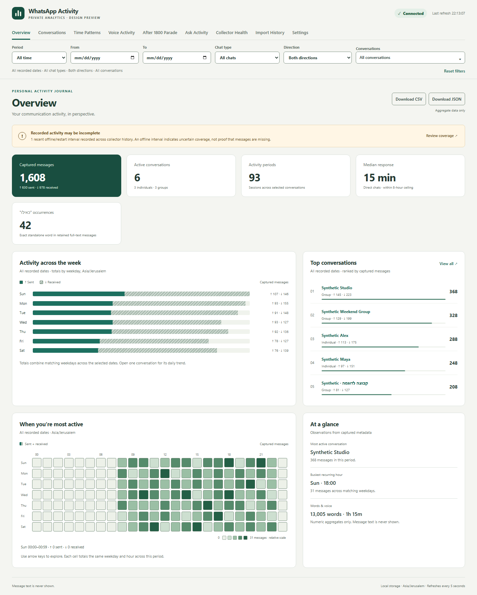
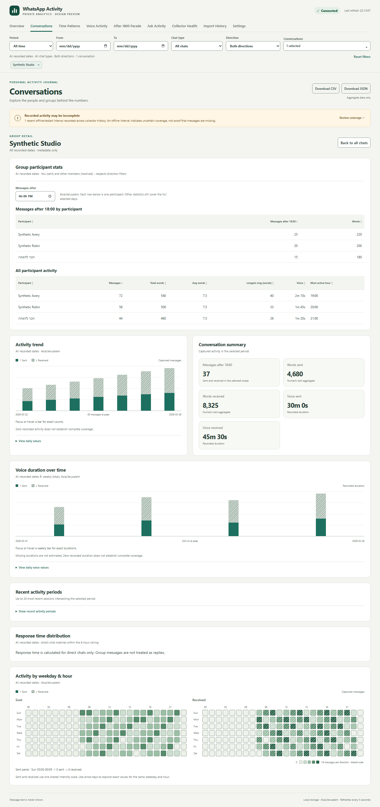
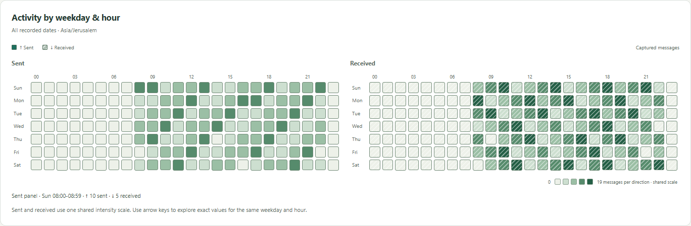
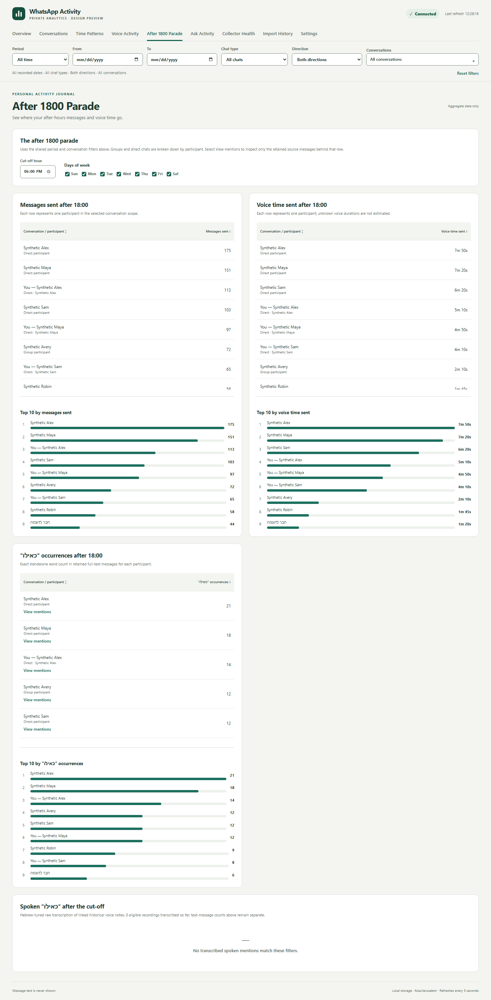
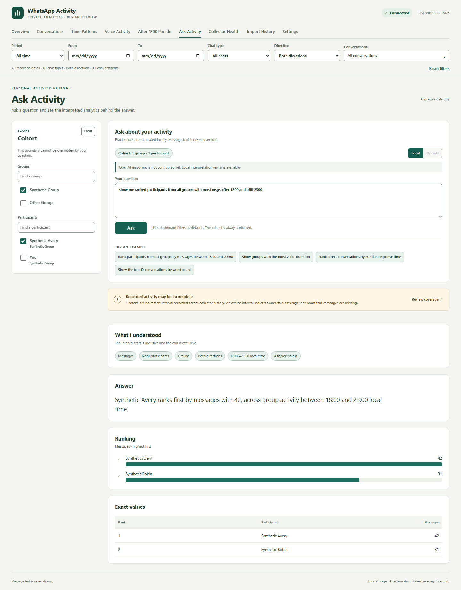

# WhatsApp Activity Dashboard

A local dashboard for exploring activity from one WhatsApp account. It summarizes counts and timing across conversations while making gaps in collection visible. It does not send WhatsApp messages.

The application runs on the owner's computer with Docker Compose and SQLite. Collection uses a linked WhatsApp Web session. The owner controls whether each conversation retains message text locally, keeps only activity metadata, or is excluded.

## Main views

These screenshots use invented names and activity data. They were captured with synthetic API responses, not from a live account.

### Overview

See message totals, active conversations, activity periods, response time, weekly trends, and a weekday-by-hour heatmap. A coverage notice warns when collection may be incomplete.

### Conversation detail

Choose a conversation to see its trend. Group detail separates participants and shows message, word-count, and voice-duration totals, including activity after a chosen local time.

### Time patterns

Compare sent and received activity by local weekday and hour. The dashboard also provides voice activity and collector-health views.

### After 1800 Parade

Rank messages and voice-note time from a chosen local cutoff (18:00 by default) through the end of each selected day. The view keeps direct-chat directions and group participants separate, and lets you narrow the ranking by day of week. Where text is retained locally, a word-occurrence ranking can show matching source messages for one selected row.

### Ask Activity

Ask for rankings and other numeric summaries within a selected group or participant scope. Exact filtering and calculations run locally; the screen shows how it interpreted the question.

## About this public repository

It contains only this README and five synthetic screenshots. Application source, configuration, development history, and personal data stay private. This repository is an overview, not an installable release.
